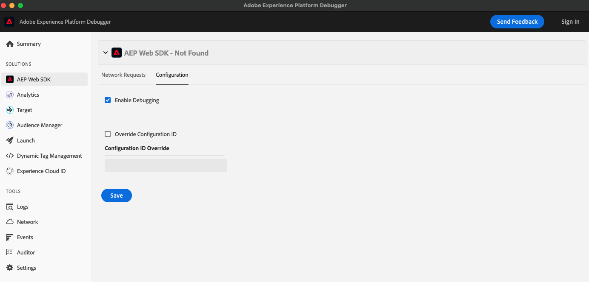

# Enable debug logging for data collection

Diagnostic logging helps explain SDK commands, tag execution, warnings, and errors in the runtime where your implementation runs. Use it with [request inspection](inspect-requests.md) when you also need to inspect requests or processing. If you are unsure where to start, see the [Debugging and troubleshooting overview](overview.md).

## Choose a logging method {#choose-a-logging-method}

| Implementation | Enable logging | Where to read it | Scope and reset |
| --- | --- | --- | --- |
| Web SDK, implemented directly | `debugEnabled`, `setDebug`, the `alloy_debug` query parameter, or Debugger | Browser console | `debugEnabled` applies to every visitor who runs that configuration. `setDebug` and `alloy_debug` apply only to your browser tab, persist across same-origin page loads in that tab, and take precedence over `debugEnabled`. Explicitly disable them when finished. |
| Tags, including extension-managed Web SDK | `_satellite.setDebug(true)` | Browser console | Applies only to your browser. Stored in local storage for the origin, so it persists across page loads and browser restarts until you run `_satellite.setDebug(false)` or clear site data. |
| Server SDK | `debugEnabled` or `setDebug` | Server console/log output | Configuration sets the baseline for the instance and request handles. Runtime changes affect only the instance or handle called. Settings do not survive a process restart unless your code reapplies them. |
| Mobile SDK | `MobileCore.setLogLevel` | Android Logcat or the iOS development console | Applies within the running app. Set the desired level during initialization on each launch; restore error-level logging after debugging. |

Web SDK, tag-library, and Server SDK debug logging is disabled by default. Mobile SDK defaults to error-level logging rather than no logging.

>[!IMPORTANT]
>
>Debug messages can contain event data and visitor identifiers. Prefer local or development-only debugging, avoid verbose production logging, and remove sensitive information before sharing output. Logging does not prove that the Edge Network or a downstream service received and processed an event.

## Enable logging by library {#enable-logging}

Expand the section for the library that your implementation uses. Each section explains how to enable logging, where to read the output, and how to turn logging off.

+++**Web SDK**

The following methods control Web SDK diagnostic output. They do not enable tag-library logging for a standalone Web SDK implementation.

**`debugEnabled` in the `configure` command**: Set `debugEnabled` to `true` in your existing [`configure`](../js/commands/configure/overview.md) call. This setting is useful in development environments. If deployed in your site's code, it enables logging for visitors who run that configuration.

```js
alloy("configure", {
  datastreamId: "ebebf826-a01f-4458-8cec-ef61de241c93",
  orgId: "ADB3LETTERSANDNUMBERS@AdobeOrg",
  debugEnabled: true
});
```

Change the configuration value to `false` or omit it in subsequent deployments to restore the default. Do not run `configure` a second time on the same instance to toggle logging; use `setDebug` instead. A local debug override can take precedence over the configuration value. See [`debugEnabled`](../js/commands/configure/debugenabled.md) for the configuration reference.

**The `setDebug` command**: Run the command against the appropriate Web SDK instance in your browser console:

```js
alloy("setDebug", { enabled: true });
```

When finished, disable it:

```js
alloy("setDebug", { enabled: false });
```

Running this command in your console changes your local instance, not other visitors' browsers. If you put the same command in deployed site code, it affects visitors who execute that code. The local override can persist across page loads for that instance in the same-origin tab session when browser storage is available. See [`setDebug`](../js/commands/setdebug.md) for more information.

**The `alloy_debug` query string parameter**: Add `alloy_debug=true` to the page URL, then load the page:

```text
https://example.com/?alloy_debug=true
```

Use `&alloy_debug=true` if the URL already has query parameters. This parameter enables logging locally without changing deployed code. Web SDK reads the parameter when each instance is created, so it applies to every Web SDK instance on the page. When browser storage is available, the setting persists for the tab's same-origin session, so removing the parameter alone does not disable logging. Load the page with `alloy_debug=false` or run `setDebug` with `enabled: false` to disable it. If the URL still contains `alloy_debug=true`, reloading it enables logging again.

**Adobe Experience Platform Debugger**: Open [Adobe Experience Platform Debugger](/help/debugger/home.md), select the Web SDK section, and enable debugging in its configuration tab. Turn the option off when you finish.



This procedure enables diagnostic output; using the Debugger for request or Edge inspection is covered in [Inspect data collection requests](inspect-requests.md).

+++

+++**Tags and the Web SDK tag extension**

On a page with a tag library, run the following in your browser console:

```js
_satellite.setDebug(true);
```

This command exposes tag-library messages, including [`_satellite.logger`](../tags/logger.md) output. For Web SDK instances managed by the Web SDK tag extension, the extension uses tag debug mode when configuring the SDK and forwards subsequent debug-mode changes to it. Do not assume that turning on debugging for a standalone or externally configured Web SDK instance also enables tag logging.

The Web SDK tag extension does not provide a debug toggle in its tags configuration UI. Use the console method for an extension-managed instance. Keep it out of tag rules.

To disable tag debug mode and the corresponding extension-managed SDK logging:

```js
_satellite.setDebug(false);
```

Tag debug mode is stored in the browser's local storage for the page's origin. It persists across page loads and browser restarts until you disable it or clear the site's data, and it does not enable logging for other visitors. See [`_satellite.setDebug()`](../tags/setdebug.md) for scope and persistence details.

The tag library notifies the extension only when tag debug mode changes. If tag debug mode is already on but Web SDK messages are missing, a Web SDK override from `setDebug` or `alloy_debug` might have turned SDK logging off. Run `_satellite.setDebug(false)` and then `_satellite.setDebug(true)`, or use the same Web SDK method that set the override.

+++

+++**Server SDK**

The [Server SDK](../server-js/overview.md) writes diagnostic output to the server console, not the visitor's browser.

Set `debugEnabled: true` in your existing server-side `configure` call to enable logging for the instance and the `forRequest` handles created from that configuration. The default is `false`. See [`debugEnabled`](../server-js/methods/configure/debugenabled.md) for a complete configuration example.

For a targeted investigation, call [`setDebug`](../server-js/methods/setdebug.md) on the request-scoped handle returned by [`forRequest`](../server-js/methods/forrequest.md). Logging changes only for that handle, so you can debug a single request without enabling it for all visitors:

```js
const visitor = alloy.forRequest({ request: req });

await visitor.setDebug({ enabled: true });
await visitor.sendEvent({
  xdm: { eventType: "web.webpagedetails.pageViews" }
});
```

Calling `setDebug` on the top-level instance changes logging only for calls made directly on that instance, not for its request handles, until you disable it or the process restarts. To change the baseline for all request handles, update `debugEnabled` in the server's configuration.

Messages identify the instance in square brackets, such as `[alloy]`, and include configuration, method inputs/results, warnings, and errors. Review the server process's output or the log destination to which your hosting environment routes it.

+++

+++**Mobile SDK**

Use Mobile Core's [`setLogLevel`](https://developer.adobe.com/client-sdks/home/base/mobile-core/api-reference/#setloglevel) API to select diagnostic verbosity. Android defaults to `LoggingMode.ERROR`; iOS defaults to `LogLevel.error`. Set the desired level during app initialization before reproducing the issue.

**Android**: Enable verbose logging in your development app:

```kotlin
import com.adobe.marketing.mobile.LoggingMode
import com.adobe.marketing.mobile.MobileCore

MobileCore.setLogLevel(LoggingMode.VERBOSE)
```

View output in Android Studio's **Logcat** for the running app process. Mobile SDK messages use the `AdobeExperienceSDK` tag, so filter with `tag:AdobeExperienceSDK` and make sure the log viewer allows debug and verbose messages. Restore error-level logging when finished:

```kotlin
MobileCore.setLogLevel(LoggingMode.ERROR)
```

**iOS**: Enable trace logging in your development app:

```swift
import AEPCore
import AEPServices

MobileCore.setLogLevel(.trace)
```

View the running app's console in Xcode and filter for `AEP SDK`. Restore error-level logging when finished:

```swift
MobileCore.setLogLevel(.error)
```

Returning to error level reduces diagnostic output; it does not suppress errors. These calls change logging in the running app, not other installations. Ensure your initialization code does not re-enable verbose logging on the next launch or in a production build.

See the [Mobile Core API reference](https://developer.adobe.com/client-sdks/home/base/mobile-core/api-reference/#setloglevel) for Java, Objective-C, supported levels, and version-specific details. For React Native or Flutter, use the API exposed by your [Mobile SDK wrapper](https://developer.adobe.com/client-sdks/home/) rather than copying native calls directly into wrapper code. For connected event inspection rather than runtime console output, see [Assurance](inspect-requests.md#mobile-server).

+++

## Read and troubleshoot diagnostic output {#read-output}

Use the following identifiers to find SDK and tag messages in busy log output. If you renamed a Web SDK or Server SDK instance, look for that name instead of `alloy`.

| Source | Look for |
| --- | --- |
| Web SDK | The instance name in brackets, such as `[alloy]`, followed by a component name for component messages |
| Tags | `🚀` followed by the originating rule, extension, or data element name in brackets. See [`_satellite.logger`](../tags/logger.md). |
| Server SDK | The instance name in brackets, such as `[alloy]` |
| Mobile SDK (Android) | The Logcat tag `AdobeExperienceSDK` |
| Mobile SDK (iOS) | `AEP SDK`, followed by the log level and the extension label |

* **Check the output location**: Browser settings do not expose server or native-app logs. Select the correct browser page, server process, or app process.
* **Check log levels**: Web SDK messages use standard console levels that browsers show by default. Messages from `_satellite.logger.debug()` require the console's verbose level, and Mobile SDK debug and verbose messages require a log viewer that includes those levels.
* **Enable logging before the action**: Existing messages are not recreated just because you turn logging on. Reproduce the issue after enabling it.
* **Check the active control**: Web SDK local overrides can supersede configuration. Tags and standalone SDK instances do not necessarily share a setting.
* **Distinguish logs from transport evidence**: A log can show that a command ran or a transport was selected without proving receipt. See [Inspect data collection requests](inspect-requests.md) to inspect requests, responses, and supported processing views.

Web SDK [monitoring hooks](../js/monitoring-hooks.md) are a separate programmatic mechanism and run regardless of the debug-logging setting. Raw API clients, datastreams, and event forwarding do not share one universal SDK logging switch; use their application logs or [service diagnostics](inspect-requests.md#edge-processing) as appropriate.
