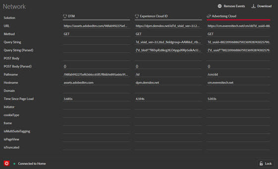
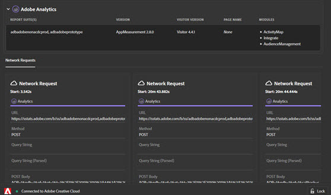
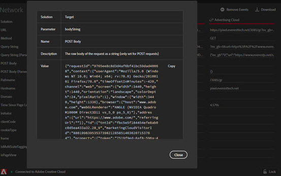

# Network tab

The **Network** tab aggregates all of the Adobe CX Enterprise solution calls made on the page and displays each request as a column, with the most recent request on the left. Standard parameters are automatically labeled with friendly names and arranged to group common parameters on the same row. Each column header shows the request type, such as `Analytics · Page view` or `Concierge · Voice conversation`, and the request number.

This screen is useful for comparing key value pairs across hits. You can confirm that parameters used for integrations, such as the ECID or the Supplemental Data ID, are consistent across integrations.

>[!NOTE]
>
>At this time, not all parameters passed in the solution calls (for example, Analytics context variables, Target custom parameters, or Visitor ID Service Customer IDs) are visible in the Network screen.

To change the information by solution, select the solution you want to view from the list in the left nav. The following example is filtered to show only Analytics:

To return to displaying all solutions, select **[!UICONTROL Network]**

Select on an item in the Network view to see an expanded view. From the expanded view window, you can copy the information shown to the Clipboard.

<!--
Use the icon at the top of each column to copy the server call URL to your clipboard, where you can paste it into another document for reference or debugging purposes.

-->

## Filter, search, and navigate requests {#filter-search}

Starting in Debugger version 1.8.0, the request tables in the **[!UICONTROL Network]** tab and in each solution tab include the following controls:

* **Solution buttons**: Available in the **[!UICONTROL Network]** tab only. Select one or more solutions to show only their requests. Select **[!UICONTROL All]** to show requests from every solution.
* **[!UICONTROL Request types]**: Select which request types to show, such as Analytics page views, Web SDK events, media events, or Brand Concierge conversations. The menu shows the number of captured requests of each type.
* **[!UICONTROL Find in requests]**: Search for an event, ID, or any raw value. Search highlights matching requests, rows, and values, but it does not hide requests that don't match. To move between matching requests, select the previous and next arrow buttons next to the search field, or press Enter to go to the next match and Shift+Enter to go to the previous match. Press Escape to clear the search.
* **[!UICONTROL Reset view]**: Clears the request type filter and search. In the **[!UICONTROL Network]** tab, it also shows requests from all solutions again.

The request count shows the number of captured requests. When filters hide some requests, the count also shows the number of requests shown. When you search, it also shows the number of matching requests.

When the table contains more requests than fit in the window, arrow buttons appear at the left and right edges of the table. Select these buttons to jump to the oldest or most recent request.

## Clear and download requests {#clear-download}

To clear the list, select **[!UICONTROL Clear events]**.

To download an Excel file containing the information on this screen, select **[!UICONTROL Download]**. In the **[!UICONTROL Network]** tab, the download includes requests from the selected solutions. Request type filters and search do not change which requests are downloaded.
