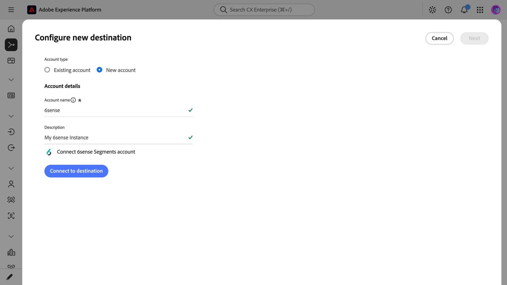
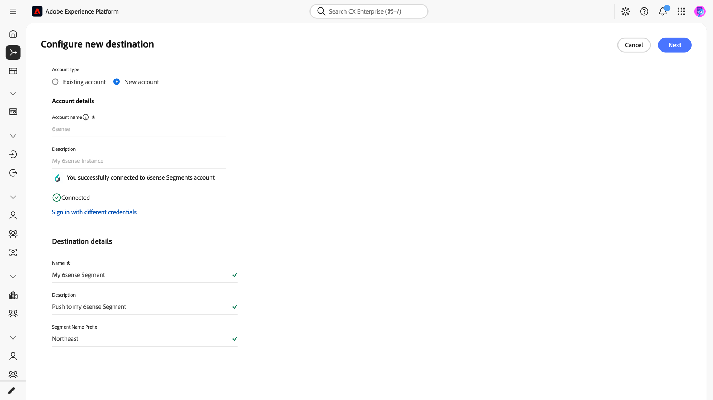
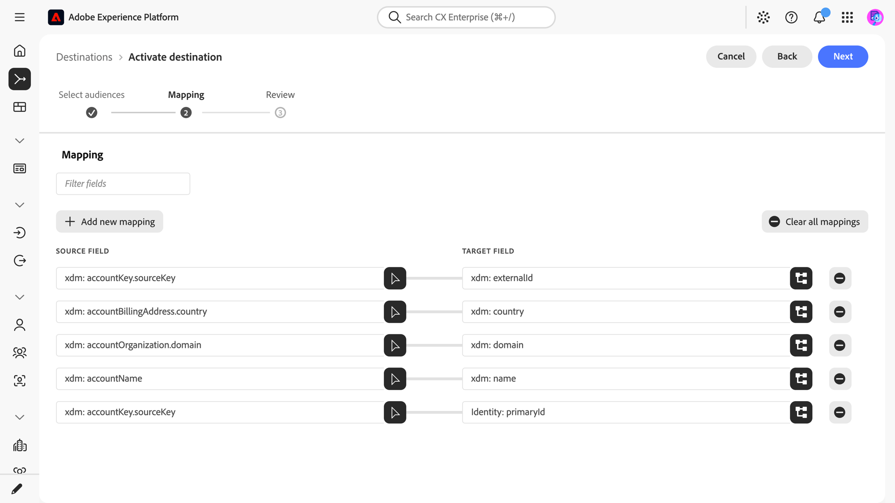
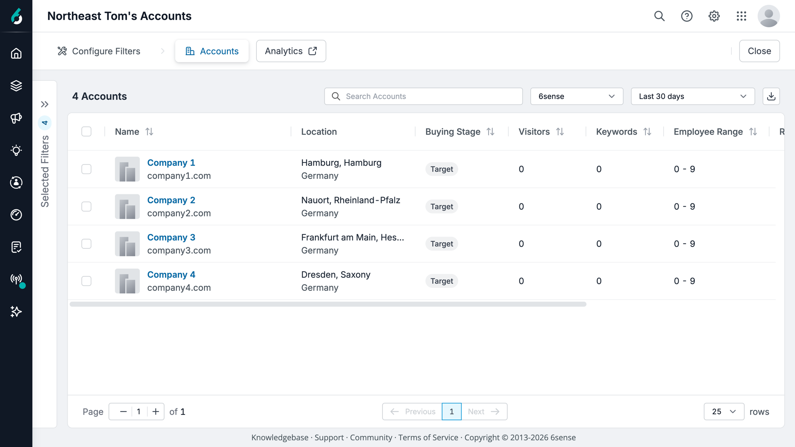

# [!DNL 6sense Account] connection {#sixsense-account}

[!DNL 6sense] is a go-to-market (GTM) intelligence platform that uses AI to identify in-market accounts and run campaigns against them. Use this destination to send [account audiences](/help/segmentation/types/account-audiences.md) from [!DNL Adobe Experience Platform] to [!DNL 6sense] as segments.

>[!AVAILABILITY]
>
>The [!DNL 6sense Account] destination is in beta and is available only to select customers. The functionality and documentation are subject to change.
>
>Your organization must purchase [!DNL Adobe Real-Time CDP B2B Edition] to activate account audiences to this destination. Learn about the [Business-to-Business edition](/help/rtcdp/overview.md#rtcdp-b2b). You also need a [!DNL 6sense] account with Segments API access enabled.

## How the destination works {#overview}

[!DNL 6sense] creates an API-origin segment from each activated audience. Then, it matches each audience member to an account by using the [!DNL 6sense] identity graph. You can then use the segment for ad campaigns, AI email campaigns, reporting, and other revenue activations in [!DNL 6sense].

For more information, read the [6sense documentation for this integration](https://app.6sense.com/go/adobe-destinations).

>[!IMPORTANT]
>
>This destination connector and documentation page are created and maintained by the [!DNL 6sense] team. For any inquiries or update requests, contact them directly at [6sense Support](https://support.6sense.com/).

## Use cases {#use-cases}

To help you better understand how and when you should use the [!DNL 6sense Account]  destination, here are sample use cases that [!DNL Adobe Experience Platform] customers can solve by using this destination.

### Advertising and campaign activation {#advertising-campaign-activation}

A B2B software company builds an account audience in Experience Platform. The audience contains accounts that recently engaged with its website and webinars. The company sends the audience to [!DNL 6sense] as a segment. The marketing team then targets those accounts in [!DNL 6sense] ad campaigns and AI email. Spend then goes to accounts that both first-party engagement and [!DNL 6sense] intent data rate as high value.

### Account prioritization and sales alignment {#account-prioritization}

A marketing team defines its target accounts in Experience Platform and sends them to [!DNL 6sense]. [!DNL 6sense] combines the list with its intent and buying-stage data. Marketing and sales use the combined view to rank accounts. Both teams then work from the same account list.

## Prerequisites {#prerequisites}

Before you connect to [!DNL 6sense], confirm that you have:

* An active [!DNL 6sense] account with Segments API access enabled. Contact your [!DNL 6sense] Customer Success Manager (CSM) to confirm.
* A [!DNL 6sense] user with the Primary Admin role. This user authorizes the connection.
* Account audiences in Experience Platform with the company domain populated.
* Account audience activation enabled for your Experience Platform organization. To enable it, contact your Adobe account team.

### Connection authorization {#connection-authorization}

[!DNL 6sense] owns the OAuth application and client credentials for this destination. You do not need to create an application or manage client secrets.

The connection uses the OAuth 2.0 Authorization Code flow. When you connect, Experience Platform redirects you to [!DNL 6sense] to sign in and grant access. Experience Platform stores the access and refresh tokens and refreshes the access token when needed.

The connection requests the following [!DNL 6sense] scopes:

* `segments.api_segment:read`
* `segments.api_segment:write`
* `segments.api_segment:delete`

## Supported identities {#supported-identities}

The [!DNL 6sense Account] destination supports activating the identities in the following table. Learn more about [identities](/help/identity-service/features/namespaces.md).

| Target identity | Description | Considerations |
|---|---|---|
| `primaryId` | The account identity. Accepts all standard and custom identity namespaces. | You must map an account identity to `primaryId`, for example `xdm: accountKey.sourceKey`. [!DNL 6sense] does not use this identity to match accounts. To set the [!DNL 6sense] `external_id`, map the `xdm: externalId` target field. Read [Map attributes and identities](#map). |

{style="table-layout:auto"}

## Supported audiences {#supported-audiences}

This section describes which types of audiences you can export to this destination.

| Audience origin | Supported | Description |
|---------|----------|----------|
| [!DNL Segmentation Service] | Yes | Audiences generated through the Experience Platform [Segmentation Service](/help/segmentation/home.md).|
| All other audience origins | Yes | This category includes all audience origins outside of audiences generated through the [!DNL Segmentation Service]. Read about the [various audience origins](/help/segmentation/ui/audience-portal.md#customize). Some examples include: <ul><li>custom upload audiences [imported](/help/segmentation/ui/audience-portal.md#import-audience) into Experience Platform from CSV files</li><li>look-alike audiences</li><li>federated audiences</li><li>audiences generated in other Experience Platform apps such as [!DNL Adobe Journey Optimizer]</li></ul> Supported audience data type restrictions still apply. |

{style="table-layout:auto"}

Supported audiences by audience data type:

| Audience data type | Supported | Description | Use cases |
|--------------------|-----------|-------------|-----------|
| [People audiences](/help/segmentation/types/people-audiences.md) | No | Target specific groups of people for marketing campaigns based on their profiles. | Frequent buyers, cart abandoners |
| [Account audiences](/help/segmentation/types/account-audiences.md) | Yes | Target individuals within specific organizations for account-based marketing strategies. | B2B marketing |
| [Prospect audiences](/help/segmentation/types/prospect-audiences.md) | No | Target individuals who are not yet customers but share characteristics with your target audience. | Prospecting with third-party data |
| [Dataset exports](/help/catalog/datasets/overview.md) | No | Collections of structured data stored in the [!DNL Adobe Experience Platform] data lake. | Reporting, data science workflows |

{style="table-layout:auto"}

## Export type and frequency {#export-type-frequency}

The following table describes the destination export type and frequency.

| Item | Type | Notes |
|---------|----------|---------|
| Export type | **[!UICONTROL Audience export]** | You are exporting all members of an account audience with the mapped company attributes and the account identifier. [!DNL 6sense] creates a segment from the audience and adds the qualifying accounts. |
| Export frequency | **[!UICONTROL Streaming]** | Streaming destinations are always-on, API-based connections. When account audience membership changes in Experience Platform, the connector sends the update to [!DNL 6sense]. Read more about [streaming destinations](/help/destinations/destination-types.md#streaming-destinations). |

{style="table-layout:auto"}

## Connect to the destination {#connect}

>[!IMPORTANT]
>
>To connect to the destination, you need the **[!UICONTROL View Destinations]** and **[!UICONTROL Manage Destinations]** [access control permissions](/help/access-control/home.md#permissions). Read the [access control overview](/help/access-control/ui/overview.md) or contact your product administrator to obtain the required permissions.

To connect to this destination, follow the steps described in the [destination configuration tutorial](../../ui/connect-destination.md). In the configure destination workflow, fill in the fields described in the following sections.

### Authenticate to destination {#authenticate}

To authenticate to the destination, fill in the required fields and select **[!UICONTROL Connect to destination]**.

{zoomable="yes"}

* **[!UICONTROL Account name]**: A name to identify this account.
* **[!UICONTROL Description]**: A description to help you identify this account. This field is optional.

[!DNL 6sense] then prompts you to sign in and authorize the connection. After authorization, [!DNL 6sense] redirects you to Experience Platform. Later activations reuse the stored tokens. Learn about [connection authorization](#connection-authorization).

### Fill in destination details {#destination-details}

>[!CONTEXTUALHELP]
>id="platform_destinations_connect_6sense_segmentnameprefix"
>title="Segment Name Prefix"
>abstract="Optional text that Experience Platform adds before each audience name when it creates the segment in [!DNL 6sense]. Use only letters, numbers, spaces, and the characters `_`, `-`, `#`, and `/`. The prefix does not count toward the 64-character segment name limit."
>additional-url="https://experienceleague.adobe.com/docs/experience-platform/destinations/catalog/advertising/6sense.html#segment-creation" text="Learn how segments are named"

To configure details for the destination, fill in the following required and optional fields. An asterisk next to a field in the UI indicates that the field is required.

{zoomable="yes"}

* **[!UICONTROL Name]**: A name to identify this destination.
* **[!UICONTROL Description]**: A description to help you identify this destination. This field is optional.
* **[!UICONTROL Segment Name Prefix]**: Text to add before each audience name in [!DNL 6sense], for example `Experience Platform - `. Use only [supported characters](#segment-creation). This field is optional.

### Enable alerts {#enable-alerts}

You can enable alerts to receive notifications on the status of the dataflow to your destination. Select an alert from the list to subscribe to receive notifications on the status of your dataflow. For more information on alerts, read the guide on [subscribing to destinations alerts using the UI](../../ui/alerts.md).

When you are finished providing details for your destination connection, select **[!UICONTROL Next]**.

## Activate audiences to this destination {#activate}

>[!IMPORTANT]
>
>* To activate data, you need the **[!UICONTROL View Destinations]**, **[!UICONTROL Activate Destinations]**, **[!UICONTROL View Profiles]**, and **[!UICONTROL View Segments]** [access control permissions](/help/access-control/home.md#permissions). Read the [access control overview](/help/access-control/ui/overview.md) or contact your product administrator to obtain the required permissions.
>* To export *identities*, you need the **[!UICONTROL View Identity Graph]** [access control permission](/help/access-control/home.md#permissions).   {width="100" zoomable="yes"}

Read [Activate account audiences](/help/destinations/ui/activate-account-audiences.md) for instructions on activating account audiences to this destination.

### Map attributes and identities {#map}

In the mapping step of the activation workflow, map your account fields to the following target fields. You must map an account identity to `primaryId`. The attribute mappings are optional in the UI. However, [!DNL 6sense] needs a domain to match accounts reliably.

| Example source field | Target field | Description |
|---|---|---|
| `xdm: accountKey.sourceKey` | `Identity: primaryId` | The account identity. This mapping is required. |
| `xdm: accountOrganization.domain` | `xdm: domain` | The company domain. [!DNL 6sense] uses this value as the primary matching field. |
| `xdm: accountName` | `xdm: name` | The company name. [!DNL 6sense] uses this value as a fallback matching signal. |
| `xdm: accountBillingAddress.country` | `xdm: country` | The country name. [!DNL 6sense] uses this value with the country-specific match type. |
| `xdm: accountKey.sourceKey` | `xdm: externalId` | The account identifier from your system. [!DNL 6sense] stores this value as the `external_id` of the record and uses it to identify the record during removals. [!DNL 6sense] does not use it to match accounts. |

{style="table-layout:auto"}

{zoomable="yes"}

Your organization can use the standard B2B schema or a custom schema, so your source field names can differ. Confirm which fields your organization populates before you map them. If you map a field with no data, [!DNL 6sense] cannot use it to match the account. For field definitions, see the [account details data type reference](/help/xdm/data-types/account-details.md).

## Validate the data export {#exported-data}

On first activation, [!DNL 6sense] creates a segment from the audience and adds the initial members. After that, Experience Platform sends membership updates to the same segment.

To validate the export, open the **[!UICONTROL Segments]** tool in [!DNL 6sense] and select the **[!UICONTROL Segments]** tab. Locate the segment named after your audience, and then open it. The **[!UICONTROL Accounts]** tab lists the matched accounts.

{zoomable="yes"}

[!DNL 6sense] processes requests asynchronously and matches accounts in the segment during its nightly refresh. Accounts that Experience Platform sends during the day appear as matched accounts after the next nightly refresh.

[!DNL 6sense] matches accounts by using its own identity graph. Experience Platform does not have visibility into which accounts matched or why an account did not match. Contact [6sense Support](https://support.6sense.com/) about match rates or unmatched accounts.

### Segment creation {#segment-creation}

[!DNL 6sense] names the segment after the Experience Platform audience, with your optional [segment name prefix](#destination-details) added in front.

Before Experience Platform creates the segment, it shortens the audience name to 64 characters and replaces unsupported characters with underscores. Supported characters are the letters A-Z and a-z, the numbers 0-9, spaces, and `_`, `-`, `#`, and `/`. Experience Platform also replaces accented and other non-ASCII letters with underscores.

Experience Platform does not shorten or change the segment name prefix. The prefix also does not count toward the 64 characters. Keep the prefix short and use only supported characters.

You can activate an audience that has no members. [!DNL 6sense] creates an empty segment and adds accounts as they qualify.

### Account additions and removals {#account-additions-removals}

When an account qualifies for the audience, Experience Platform adds it to the corresponding [!DNL 6sense] segment.

When an account no longer qualifies for the audience, Experience Platform removes it from the [!DNL 6sense] segment. This change removes only the segment membership in [!DNL 6sense]. Deleting an account or profile in Experience Platform also removes its segment membership.

### Audience deletion and renaming {#audience-deletion}

Deleting an activated account audience in Experience Platform does not delete or archive the corresponding [!DNL 6sense] segment. To delete the segment, sign in to [!DNL 6sense] as an administrator and complete the following steps:

1. In [!DNL 6sense], open the **[!UICONTROL Segments]** tool, and then select the **[!UICONTROL Segments]** tab.
1. Locate the segment, and then open the actions menu for that row.
1. Select **[!UICONTROL Delete]**, and then confirm **[!UICONTROL Delete]**.

If **[!UICONTROL Delete]** is unavailable, the segment might have active activations or dependencies, or you might not have edit permissions.

Renaming an audience in Experience Platform does not rename the [!DNL 6sense] segment. Membership updates continue to sync. To keep the names aligned, sign in to [!DNL 6sense] as an administrator and rename the segment:

1. In [!DNL 6sense], open the **[!UICONTROL Segments]** tool, and then select the **[!UICONTROL Segments]** tab.
1. Locate the segment, and then open the actions menu for that row.
1. Select **[!UICONTROL Edit]**, and then rename the segment.

### Troubleshoot the export {#troubleshooting}

If an activated audience does not send data, confirm that the audience is activated, scheduled, and contains accounts. If the dataflow run still does not start, contact Adobe Customer Care.

If accounts reach [!DNL 6sense] but do not match, contact [6sense Support](https://support.6sense.com/).

## Data usage and governance {#data-usage-governance}

All [!DNL Adobe Experience Platform] destinations are compliant with data usage policies when handling your data. For detailed information on how [!DNL Adobe Experience Platform] enforces data governance, read the [Data Governance overview](/help/data-governance/home.md).

## Additional resources {#additional-resources}

* [6sense documentation for the Adobe Experience Platform destination](https://app.6sense.com/go/adobe-destinations)
* [6sense Support](https://support.6sense.com/)
