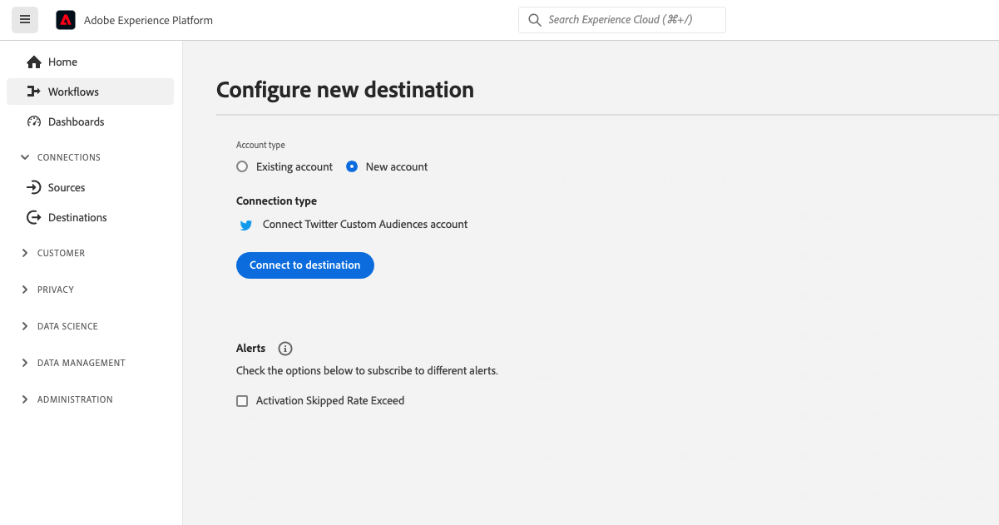
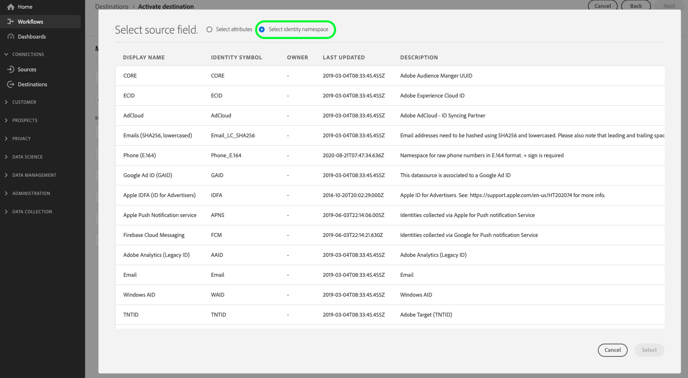

# [!DNL Twitter Custom Audiences] connection

## Destination overview {#overview}

Activate audiences that you build in [!DNL Adobe Experience Platform] to [!DNL X] (formerly [!DNL Twitter]). Use these audiences to target your existing followers and buyers with relevant remarketing campaigns.

## Prerequisites {#prerequisites}

Before you configure your [!DNL Twitter Custom Audiences] destination, make sure that you meet the following [!DNL Twitter] prerequisites.

1. Your [!DNL Twitter Ads] account must be eligible for advertising. New [!DNL Twitter Ads] accounts are not eligible for advertising in the first two weeks after you create them.
1. Your [!DNL Twitter] user account that you authorized access for in [!DNL Twitter Audience Manager] must have the *[!DNL Partner Audience Manager]* permission enabled.

## Supported identities {#supported-identities}

Activate the identities described in the following table to [!DNL Twitter Custom Audiences]. Learn more about [identity namespaces](/help/identity-service/features/namespaces.md).

|Target identity|Description|Considerations|
|---|---|---|
|device_id|IDFA/AdID/Android ID|[!DNL Experience Platform] supports Google Advertising ID (GAID) and Apple ID for Advertisers (IDFA). Map these namespaces or attributes from your source schema in the [mapping step](/help/destinations/ui/activate-segment-streaming-destinations.md#mapping) of the destination activation workflow.|
|email|Email addresses for the person|Map your plain text email addresses and your SHA256-hashed email addresses to this field. When your source field contains unhashed attributes, select the **[!UICONTROL Apply transformation]** option. [!DNL Experience Platform] then hashes the data automatically on activation. If you hash email addresses before you upload them to [!DNL Experience Platform], hash them using SHA256 without a salt.|

{style="table-layout:auto"}

## Supported audiences {#supported-audiences}

This section describes which types of audiences you can export to this destination.

| Audience origin | Supported | Description |
|---------|----------|----------|
| [!DNL Segmentation Service] | Yes | Audiences generated through the Experience Platform [Segmentation Service](/help/segmentation/home.md).|
| All other audience origins | No | This category includes all audience origins outside of audiences generated through the [!DNL Segmentation Service]. Read about the [various audience origins](/help/segmentation/ui/audience-portal.md#customize). Examples include the following: <ul><li>Custom upload audiences [imported](/help/segmentation/ui/audience-portal.md#import-audience) into Experience Platform from CSV files</li><li>Look-alike audiences</li><li>Federated audiences</li><li>Audiences generated in other Experience Platform apps such as [!DNL Adobe Journey Optimizer]</li></ul> |

{style="table-layout:auto"}

Supported audiences by audience data type:

| Audience data type | Supported | Description | Use cases |
|--------------------|-----------|-------------|-----------|
| [People audiences](/help/segmentation/types/people-audiences.md) | Yes | Based on customer profiles, allowing you to target specific groups of people for marketing campaigns. | Frequent buyers, cart abandoners |
| [Account audiences](/help/segmentation/types/account-audiences.md) | No | Target individuals within specific organizations for account-based marketing strategies. | B2B marketing |
| [Prospect audiences](/help/segmentation/types/prospect-audiences.md) | No | Target individuals who are not yet customers but share characteristics with your target audience. | Prospecting with third-party data |
| [Dataset exports](/help/catalog/datasets/overview.md) | No | Collections of structured data stored in the [!DNL Adobe Experience Platform] Data Lake. | Reporting, data science workflows |

{style="table-layout:auto"}

## Export type and frequency {#export-type-frequency}

The following table describes the destination export type and frequency.

| Item | Type | Notes |
|---------|----------|---------|
| Export type | **[!UICONTROL Audience export]** | You are exporting all members of an audience with the identifiers used in the Twitter Custom Audiences destination.|
| Export frequency | **[!UICONTROL Streaming]** | Streaming destinations are always-on, API-based connections. As soon as a profile is updated in Experience Platform based on audience evaluation, the connector sends the update downstream to the destination platform. Read more about [streaming destinations](/help/destinations/destination-types.md#streaming-destinations).|

{style="table-layout:auto"}

## Use cases {#use-cases}

Use the following sample use case to understand when to use the [!DNL Twitter Custom Audiences] destination.

### Remarketing to existing followers {#use-case-1}

Activate audiences that you build in [!DNL Adobe Experience Platform] as [!DNL List Custom Audiences] in [!DNL X]. Then target your existing followers and buyers with relevant remarketing campaigns.

## Authentication and data access {#authentication-data-access}

Review this section before you connect to the destination. It explains how the destination authenticates with [!DNL X] and what the [!DNL X] consent screen permissions mean. It also explains how Experience Platform stores your credentials and how to revoke or limit access. Security and governance reviewers can use this information to approve the connection.

### Authentication model and API usage {#authentication-model}

The [!DNL Twitter Custom Audiences] destination authenticates with [!DNL X] using OAuth 1.0a. With OAuth 1.0a, an app cannot request individual permissions. Instead, the app requests one of a few broad access levels.

The destination calls only the custom audience endpoints of the [!DNL X] Ads API, under `ads-api.twitter.com/12/accounts/{accountId}/custom_audiences`. The destination uses these endpoints to perform the following operations:

* Create, update, and delete custom audiences
* Add hashed user identifiers to custom audiences
* Remove hashed user identifiers from custom audiences

The destination does not publish posts, read or send Direct Messages, or follow or block accounts.

### Consent screen permissions {#consent-screen-permissions}

When you authorize the connection, the [!DNL X] consent screen for the [!DNL Experience Cloud Activation] app lists broad permissions. These permissions include account, post, Direct Message, follow, block, and advertising access.

The consent screen lists broad permissions because [!DNL X] groups permissions into broad access levels. The screen shows the access level of the app, plus access to ads. To manage custom audiences, the destination needs write access. In [!DNL X], write access also includes post, follow, and profile permissions. Learn more in the [X developer documentation on app management](https://docs.x.com/fundamentals/developer-apps#app-management) and the [X Help Center article on connected apps](https://help.x.com/en/managing-your-account/connect-or-revoke-access-to-third-party-apps).

The destination does not use Direct Messages, even though the consent screen lists them.

### Token storage and usage {#token-storage}

After you authorize the connection, Experience Platform encrypts the access token and stores it in your destination account. The token is scoped to your organization and sandbox. Only the activation process for this destination uses the token.

### Revoke access {#revoke-access}

To fully revoke access, complete the following steps in Experience Platform and in [!DNL X]:

1. In Experience Platform, go to **[!UICONTROL Destinations]** > **[!UICONTROL Accounts]** and delete the destination account. Before you delete the account, [delete any dataflows](/help/destinations/ui/delete-destinations.md) that use it. For detailed steps, read [Delete destination accounts](/help/destinations/ui/delete-destination-account.md).
1. In [!DNL X], go to **[!UICONTROL Connected apps]** and revoke access for the **[!DNL Experience Cloud Activation]** app. For detailed steps, read the [X Help Center article on connected apps](https://help.x.com/en/managing-your-account/connect-or-revoke-access-to-third-party-apps).

### Limit account access {#limit-account-access}

[!DNL X] does not offer a narrower authorization option for this destination. To limit exposure, authorize the connection with a dedicated [!DNL X] user. Give this user access only to the relevant ads account, with a role that allows audience management.

## Connect to destination {#connect}

To connect to this destination, follow the steps described in the [destination configuration tutorial](/help/destinations/ui/connect-destination.md). In the configure destination workflow, fill in the fields listed in the following sections.

>[!IMPORTANT]
>
>To connect to the destination, you need the **[!UICONTROL View Destinations]** and **[!UICONTROL Manage Destinations]** [access control permissions](/help/access-control/home.md#permissions). Read the [access control overview](/help/access-control/ui/overview.md) or contact your product administrator to obtain the required permissions.

### Authenticate to destination {#authenticate}

Before you authenticate, review [Authentication and data access](#authentication-data-access) to understand the permissions that [!DNL X] requests. Then complete the following steps.

1. Find the [!DNL Twitter Custom Audiences] destination in the destination catalog and select **[!UICONTROL Set Up]**.
1. Select **[!UICONTROL Connect to destination]**.

   

1. Enter your [!DNL X] credentials and select **[!UICONTROL Log In]**.

### Fill in destination details {#destination-details}

>[!CONTEXTUALHELP]
>id="platform_destinations_connect_twitter_accountid"
>title="Account ID"
>abstract="Your Twitter Ads account ID. Find this ID in your Twitter Ads settings."

To configure details for the destination, fill in the following required and optional fields. An asterisk next to a field in the UI indicates that the field is required.

*  **[!UICONTROL Name]**: A name to identify this destination.
*  **[!UICONTROL Description]**: A description to help you identify this destination.
*  **[!UICONTROL Account ID]**: Your [!DNL Twitter Ads] account ID. Find this ID in your [!DNL Twitter Ads] settings.

>[!IMPORTANT]
>
>Do not use special characters (+ & , % : ; @ / = ? $ \n) in audience, description, and audience mapping names. If your Experience Platform audience name contains these characters, remove them before you map the audience to a [!DNL Twitter] destination.

### Enable alerts {#enable-alerts}

Enable alerts to receive notifications about the status of the dataflow to your destination. Select an alert from the list to subscribe to it. For more information on alerts, read the guide on [subscribing to destinations alerts using the UI](/help/destinations/ui/alerts.md).

When you are finished providing details for your destination connection, select **[!UICONTROL Next]**.

## Activate audiences to this destination {#activate}

Read [Activate profiles and audiences to streaming audience export destinations](/help/destinations/ui/activate-segment-streaming-destinations.md) for instructions on activating audiences to this destination.

>[!IMPORTANT]
>
>* To activate data, you need the **[!UICONTROL View Destinations]**, **[!UICONTROL Activate Destinations]**, **[!UICONTROL View Profiles]**, and **[!UICONTROL View Segments]** [access control permissions](/help/access-control/home.md#permissions). Read the [access control overview](/help/access-control/ui/overview.md) or contact your product administrator to obtain the required permissions.
>* To export *identities*, you need the **[!UICONTROL View Identity Graph]** [access control permission](/help/access-control/home.md#permissions).   {width="100" zoomable="yes"}

### Mapping considerations {#mapping-considerations}

When you map audiences to [!DNL Twitter], provide human-readable audience mapping names. Use the same names that you used for the audiences in Experience Platform.

## Data usage and governance {#data-usage-governance}

All [!DNL Adobe Experience Platform] destinations comply with data usage policies when handling your data. For detailed information on how [!DNL Adobe Experience Platform] enforces data governance, read the [Data Governance overview](/help/data-governance/home.md).

## Additional resources {#additional-resources}

Learn more about [!DNL List Custom Audiences] in the [X documentation on custom audience lists](https://business.twitter.com/en/help/campaign-setup/campaign-targeting/custom-audiences/lists.html).
