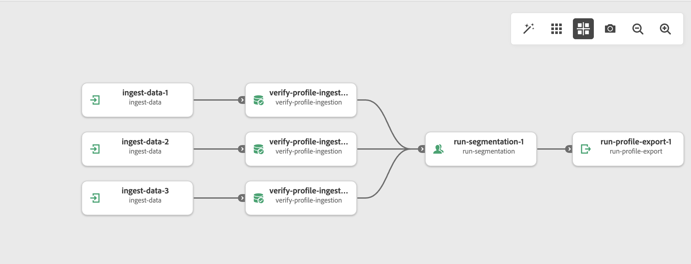
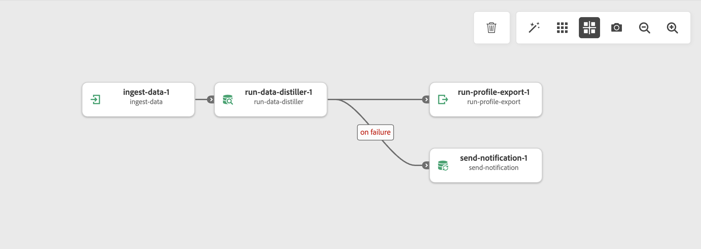

# Process Manager overview

Process Manager provides an in-built orchestration system that lets you chain together various Adobe Experience Platform services together to perform end-to-end flows. Since Process Manager is directly created by Adobe, you don't need to maintain any custom code to manage your orchestrations, and will automatically take care of any API or service upgrades that may be required for your flows. 

Process Manager provides an **active** orchestration system, which lets you take full control of every task within the workflow. As a result, you can decide when each task executes, how many times each task executes, as well as the transition logic between each task. Since every task executes within Process Manager, the entire process is fully tracked, giving you complete visibility and deterministic control over the entire lifecycle.

## Sample use cases

The following section lists some sample use cases for Process Manager.

### Trigger profile export after all data is ingested

In the following scenario, you can ingest data from multiple datasets, proceed to wait for all the data to be ingested, then trigger activation to a dataset after all the data is ingested.

### Ingest data, run Data Distiller, and activate the data to a dataset

In the following scenario, you can ingest data from a dataset, run it through Data Distiller, and upon successfully running, export the data to a dataset.

## Next steps

To learn how to use the Process Manager UI, read the [Process Manager UI guide](/help/process-manager/ui.md). To learn how to use the API to monitor your processes, read the [Process Manager API guide](/help/process-manager/api.md).
