# Process Manager UI guide

Process Manager let you natively orchestrate end-to-end use cases by chaining together multiple Adobe Experience Platform services. With the Process Manager UI, you can actively control when each of the tasks run, with a guarantee that each tasks only runs exactly once, and with automatic failure recovery.

## Process list {#list}

The **[!UICONTROL Process]** page displays a list of all the processes that have been created for your organization. This includes details such as name, number of tasks, schedule, cadence, last updated date, as well as actions for the process.

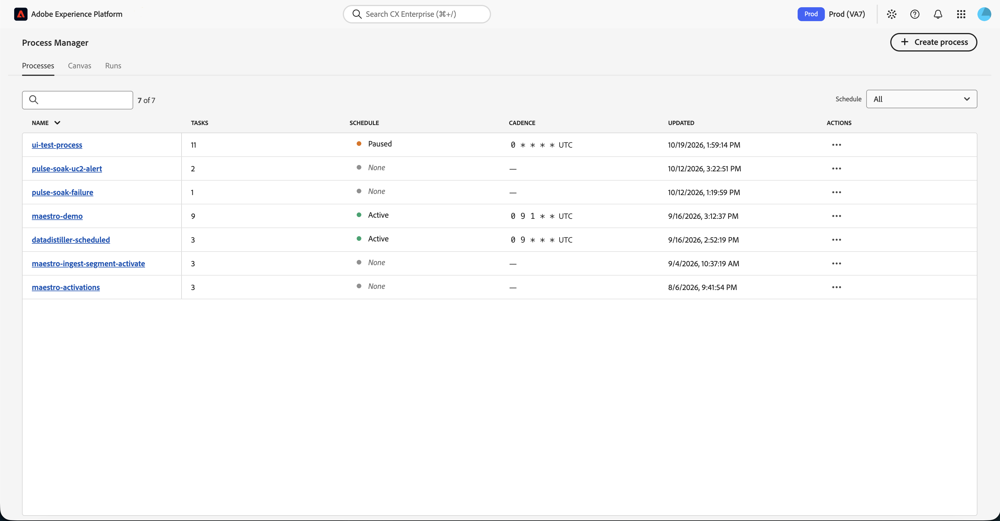

| Field | Description |
| ----- | ----------- |
| Name | The name of the process. If you select the name, you can edit the existing process. To learn more about editing the process, read the [canvas section](#canvas). |
| Tasks | The number of tasks within the process. |
| Schedule | The state of the schedule for the process. Possible values include [!UICONTROL Paused], [!UICONTROL Active], [!UICONTROL Error], and [!UICONTROL None]. |
| Cadence | The cadence which the process runs. This is written as a cron schedule. For more information about cron schedules, read the [cron expression format](https://www.quartz-scheduler.org/documentation/quartz-2.3.0/tutorials/crontrigger.html) documentation. |
| Updated | The date and time the process was last updated. |
| Actions | Available quick actions for the process. <ul><li>**Canvas**: Opens the canvas so you can edit the process. For more information on editing the process, read the [canvas section](#canvas).</li><li>**Runs**: Displays the runs associated with the process. For more information, read the [runs section](#runs).</li><li>**Schedule**:</li>Update the cadence in which the process runs. You can set the cron schedule for the process, as well as the required inputs for the process to run.</li><li>**Notifications**: Lets you add notifications for the process. You can send a notification upon the process failing and send the notification to everyone in the organization or specified users or user groups.</li><li>**Clone**: Duplicates the process.</li><li>**Delete**: Deletes the process.</li></ul> |

Additionally, you can filter the listed processes by the schedule status.

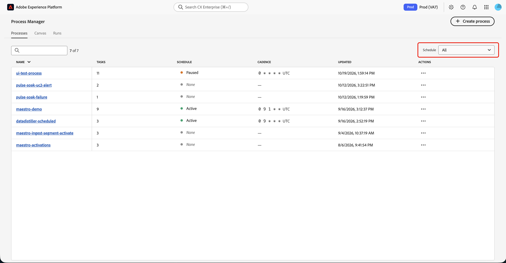

To create a new process, select **[!UICONTROL Create process]**. For more information on creating a new process, read the [canvas section](#canvas).

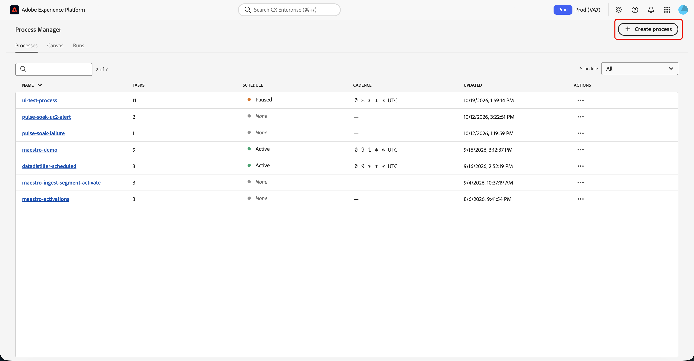

## Canvas {#canvas}

The **[!UICONTROL Canvas]** screen appears. On this page, you can create an end-to-end automated run flow.

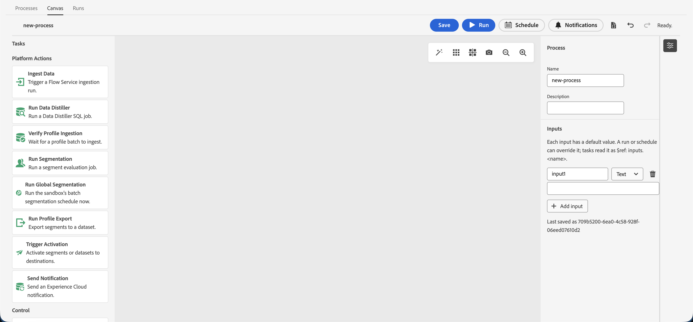

The left **[!UICONTROL Tasks]** bar displays a full list of the available actions that you can add to your process.

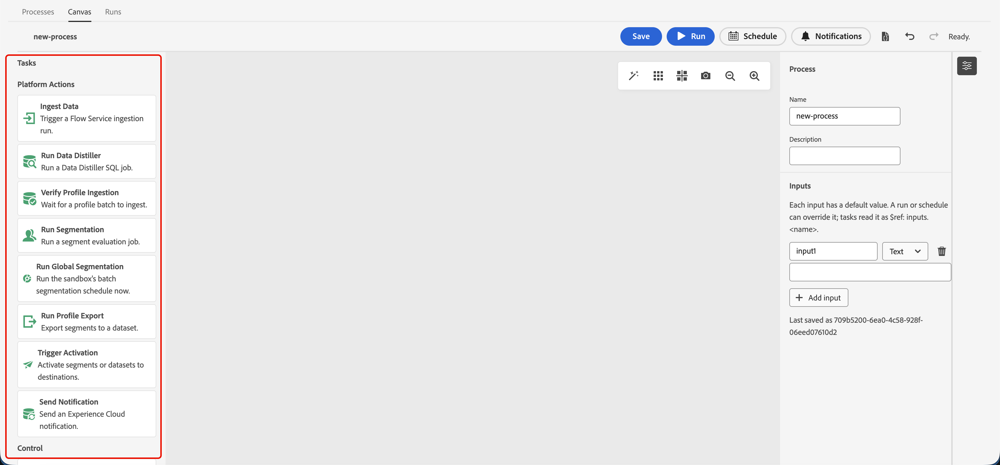

| Task | Description |
| ---- | ----------- |
| Ingest Data | Ingest data into Experience Platform. You can choose which source to ingest data from. For more information, read the [ingest data section](#ingest-data). |
| Run Data Distiller | Run a Data Distiller query template. You can select which query template you want to execute. For more information, read the [run Data Distiller section](#run-data-distiller). |
| Verify Profile Ingestion | Verifies that a Profile ingestion has completed. You can choose which batch ID you want to verify. For more information, read the [verify Profile ingestion section](#verify-profile-ingestion). |
| Run Segmentation | Runs a segmentation job. You can choose which segment definition IDs to run segmentation on. For more information, read the [run segmentation section](#run-segmentation). |
| Run Global Segmentation | Runs the sandbox's daily batch segmentation schedule. For more information, read the [run global segmentation section](#run-global-segmentation). |
| Run Profile Export | Runs a profile export job, which lets you export audiences to a dataset. You can choose which segment definitions to export and which dataset to export to. For more information, read the [run Profile export section](#run-profile-export). |
| Trigger Activation | Runs an activation job. This lets you activate audiences or a dataset to a destination. For more information, read the [trigger activation section](#trigger-activation).  |
| Send Notification | Sends a notification to users on Experience Platform. For more information, read the [send notification section](#send-notification). |
| Wait | Makes the process wait for a specified amount of time. For more information, read the [wait section](#wait). |

For more information about the available tasks, read the [tasks section](#tasks).

After you add tasks to the canvas, you can connect the tasks to chain them together for the process. To connect the tasks, select the plus icon that appears on the task while it's close to the task that you want to connect the task to.

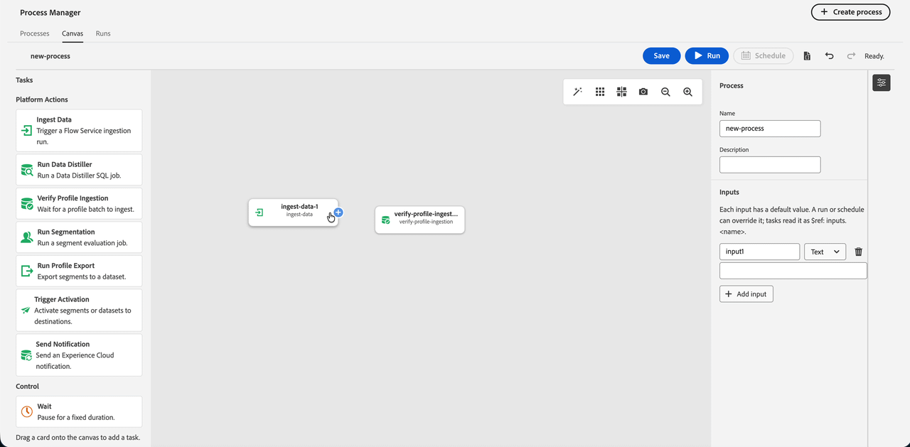

Within the canvas, you can also select from the following options to manipulate the canvas itself.

| Option | Description |
| ------ | ----------- |
| Arrange Nodes  | Arranges the nodes, so they're more neatly arranged. |
| Show Grid  | Shows the grid pattern in the canvas. |
| Snap to Grid  | Snaps the nodes on to the grid. |
| Download canvas image  | Takes a screenshot of the canvas and downloads it to your device. |
| Zoom out  | Zooms out on the canvas. |
| Zoom in  | Zooms in on the canvas. |

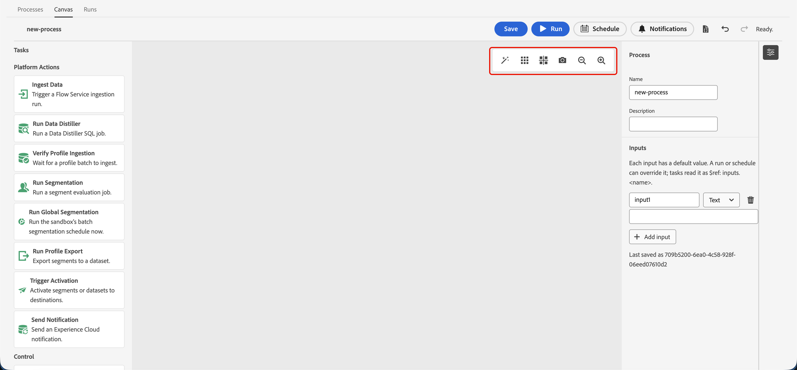

After adding all the tasks to the canvas, you can **Save** the process. Once you save the process, you can either immediately run the process or create a schedule for the process to run for.

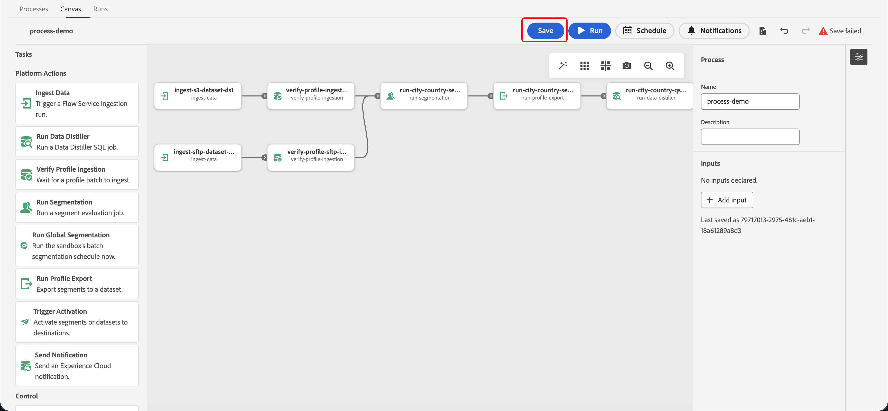

If you select **Run**, you can set the required inputs for the process to run. After inserting the inputs, select **Run** to start the process.

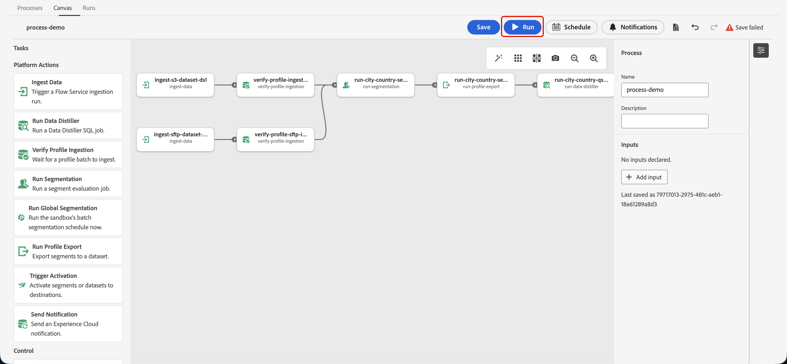

>[!NOTE]
>
>For more information about cron schedules, read the [cron expression format](https://www.quartz-scheduler.org/documentation/quartz-2.3.0/tutorials/crontrigger.html) documentation.

If you select **[!UICONTROL Schedule]**, the scheduling popover appears. On this screen, you can set the cron schedule for the process, as well as the required inputs for the process to run. For the cron schedule, you can open the dropdown to see a list of supported defaults.

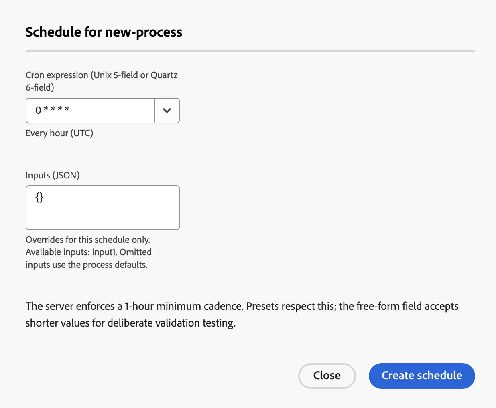

Once you've added all the information, select **[!UICONTROL Create schedule]** to create the schedule.

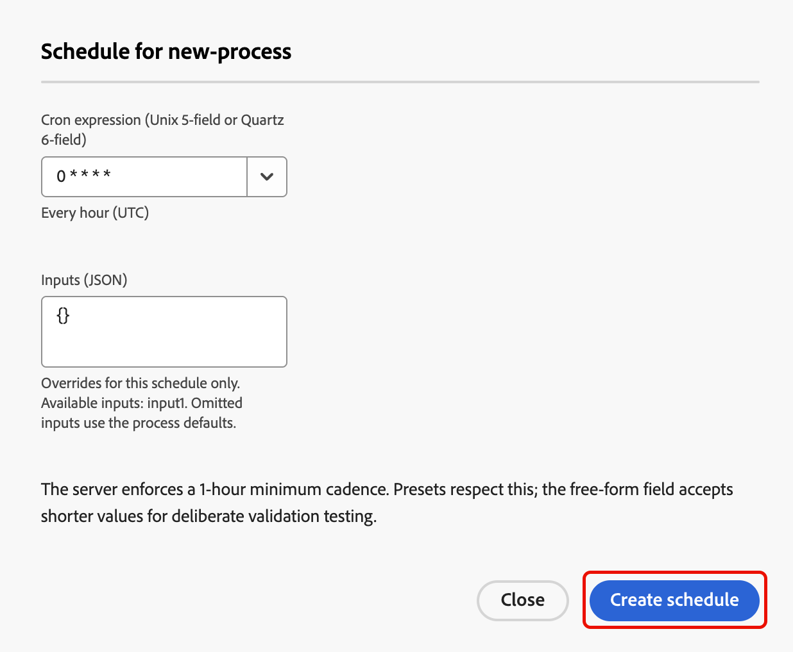

### Tasks {#tasks}

This section lists out all the available tasks that you can use with Process Manager. When adding a task to the canvas, the following settings are common to all tasks:

| Setting | Description |
| ------- | ----------- |
| Task ID | The ID of the task. |
| Task Type | The type of task. |
| Max attempts | The maximum number of attempts to retry the task if it fails. |
| Backoff coefficient | The value that sets how fast the retry interval increases. For example, setting this value to `2.0` means that the amount of time the system will take to retry the task will double between every failure. |

#### Ingest data {#ingest-data}

The **Ingest data** task lets you trigger a flow ingestion run into Experience Platform. When you use this task, you can choose which source and flow you want to ingest data from.

| Setting | Description |
| ------- | ----------- |
| Source | The name of the source that you want to ingest data from. You can select which source you want to choose from the dropdown. The number in parenthesis represents the number of available flows in the source. |
| Flow | The name of the flow that you want to ingest data from. |
| Flow ID | The ID of the flow that you want to ingest data from. This field is automatically filled out when you choose the flow in the previous dropdown. |
| startTime | The start time for the flow run. If you set the option to **Relative**, you can set the start time to be relative to the full process. For example, if you want the flow run to start three minutes after the task runs, you can set this value to `now+3m`.  If you set the option to **Absolute**, you can use the calendar to set the date. |
| windowStartTime | The start time for when data will be pulled for the flow. If you set the option to **Relative**, you can set the start time to be relative to the full process. For example, if you want the flow to look for data from 24 hours before the task runs, you can set this value to `now-24h`.  If you set the option to **Absolute**, you can use the calendar to set the date. |
| windowEndTime | The end time for when data will be retrieved up to for the flow. If you set the option to **Relative**, you can set the start time to be relative to the full process. For example, if you want the flow to look for data up until the task runs, you can set this value to `now`.  If you set the option to **Absolute**, you can use the calendar to set the date. |

For relative times, `now` represents no offset to the time. You can either use `+` or `-` to add or subtract from this zero offset. Supported units include `s` for seconds, `m` for minutes, `h` for hours, and `d` for days. 

#### Run Data Distiller {#run-data-distiller}

The **Run Data Distiller** task lets you run Data Distiller query. When you use this task, you choose the template as well as the associated parameters related to the template.

| Setting | Description |
| ------- | ----------- |
| templateId | The template ID for the Data Distiller query you want to run. |
| templateParameters | The required parameters to run the Data Distiller query. |
| failOnQueryError | Determines if the Data Distiller job fails if the query errors. You can select between true, false, or the system default. |
| database | The SQL database that the Data Distiller job should run in. |
| maxDurationSeconds | The maximum amount of time, in seconds, that the task should wait for the Data Distiller template to run. By default, this is 86,400 seconds (24 hours). |
| comment | An optional description that you can use to describe the task. |

#### Verify Profile ingestion {#verify-profile-ingestion}

The **Verify Profile ingestion** task lets you verify if the ingestion from the **Ingest data** task has successfully completed. When you use this task, you can choose which batch ID you want to verify has completed.

| Setting | Description |
| ------- | ----------- |
| batchId | The ID of the batch you want to verify has been ingested. If you chain this task with a previous **Ingest data** task, this value is automatically filled. |
| maxDurationSeconds | The maximum amount of time, in seconds, that the task should wait for verification. By default, this is 86,400 seconds (24 hours). |
| comment | An optional description that you can use to describe the task. |

#### Run Segmentation {#run-segmentation}

The **Run Segmentation** task lets you run a segmentation job on the specified segment definitions. 

| Setting | Description |
| ------- | ----------- |
| segmentIds | A dropdown that lists the available segment definitions in your organization and sandbox. You can select multiple segment definitions to be added to the task. |
| maxDurationSeconds | The maximum amount of time, in seconds, that the task should wait for the segmentation job to finish running. By default, this is 86,400 seconds (24 hours). |
| comment | An optional description that you can use to describe the task. |

#### Run Global Segmentation {#run-global-segmentation}

The Run Global Segmentation task lets you immediately run the sandbox's batch segmentation job. 

| Setting | Description |
| ------- | ----------- |
| Wait for export to complete | A toggle that determines if the global segmentation job should complete before proceeding to the next step of the process. By default, this value is enabled. |
| maxDurationSeconds | The maximum amount of time, in seconds, that the task should wait for the global segmentation job to finish running. By default, this is 86,400 seconds (24 hours). |
| comment | An optional description that you can use to describe the task. |

#### Run Profile export {#run-profile-export}

The **Run Profile export** task lets you run a Profile export job on the specified segment definitions. When you use this task, you can choose which segment definitions you want to export, what merge policy you want to use, as well as which dataset you want to export the segment definitions to.

| Setting | Description |
| ------- | ----------- |
| mergePolicyId | The ID of the merge policy you want to use for the Profile export job. |
| segmentIds |  A dropdown that lists the available segment definitions in your organization and sandbox. You can select multiple segment definitions to be added to the task. |
| datasetId | The ID of the dataset that you want to export the segment definitions to. |
| maxDurationSeconds | The maximum amount of time, in seconds, that the task should wait for the export job to finish running. By default, this is 86,400 seconds (24 hours). |
| comment | An optional description that you can use to describe the task. |

#### Trigger activation {#trigger-activation}

The **Trigger activation** task lets you activate either audiences or datasets to a specified destination. The available settings differ, depending on the Activation Type selected.

If you select **Dataset**, the following settings are available:

| Setting | Description |
| ------- | ----------- |
| Destination flowId | The flow ID of the destination you want to export to. |
| Destination datasetId | The ID of the dataset you want to export to the destination. |
| comment | An optional description that you can use to describe the task. |

If you select **Audience**, the following settings are available:

| Setting | Description |
| ------- | ----------- |
| Source datasetId | The ID of the dataset where the profiles for the activation come from. |
| Source batchId | The ID of the flow where the profiles from the activation come from. |
| Destination flowId | The flow ID of the destination you want to export to. |
| Destination segmentId | The IDs of the segment definitions you want to export to the destination. |
| comment | An optional description that you can use to describe the task. |

#### Send notification {#send-notification}

The **Send notification** task lets you send a notification to specified users on Experience Platform.

| Setting | Description |
| ------- | ----------- |
| userIds | The IDs of the users you want to send the notification to. |
| groupIds | The IDs of the groups you want to send the notification to. |
| comment | An optional description that you can use to describe the task. |
| sendToOrg | A boolean that determines if the notification is sent to the entire organization. If userIds or groupIds contain any values, this value **cannot** be set to true. |
| message | The notification message you want to send. |
| failOnError | A boolean that determines if the notification should send an error if it fails to send. |

#### Wait {#wait}

The **Wait** task causes the process execution to be paused for the specified amount of time.

| Setting | Description |
| ------- | ----------- |
| duration | The amount of time that the process should wait, as written in the ISO-8601 format. For example, if you want the process to wait 10 seconds, you'd set this value as `PT10S`. Supported values include `S` for seconds, `M` for minutes, and `H` for hours. |
| comment | An optional description that you can use to describe the task. |

## Runs {#runs}

The **Runs** page displays a list of runs for the selected process. You can either see the runs in **Grid** view or **Graph** view. 

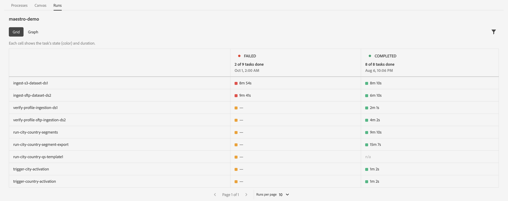

Grid view displays a list of the tasks for the process, the state of those tasks, as well as how long the tasks took.

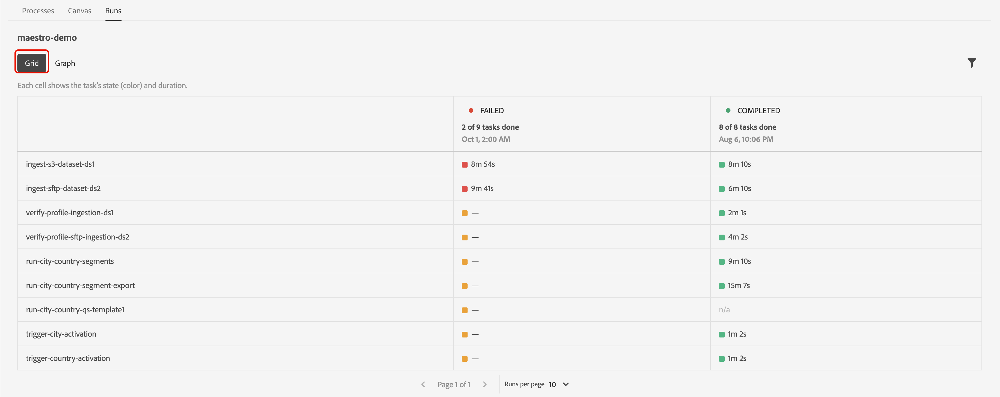

If you select the task, you can see further details about the run, including the specific error that caused the run to fail.

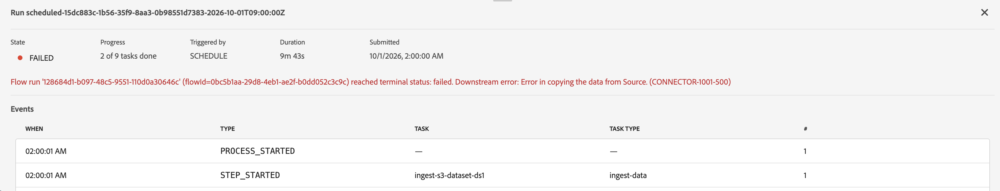

Graph view displays the selected run, with the tasks shown as individual blocks. You can see the location, state, and runtime of each of the tasks.

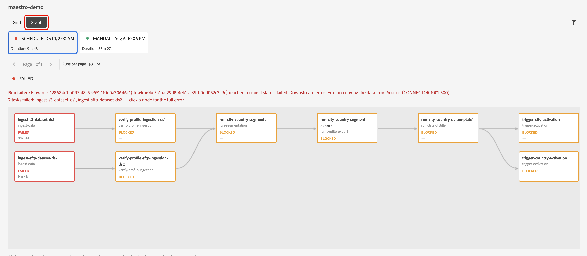

If you select a task within the run, you can see more details about the task's execution.

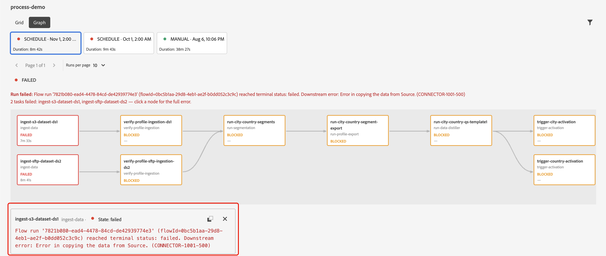
