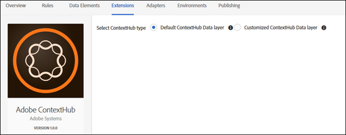

# Adobe ContextHub extension overview

Use this reference for information about configuring the Adobe ContextHub extension, and the options available when using this extension to build a rule.

## Configure the Adobe ContextHub extension

This section provides a reference for the options available when configuring the Adobe ContextHub extension.

If the Adobe ContextHub extension is not yet installed, open your property, then select **[!UICONTROL Extensions > Catalog]**, hover over the Adobe ContextHub extension, and select **[!UICONTROL Install]**.

To configure the extension, open the [!UICONTROL Extensions] tab, hover over the extension, and then select **[!UICONTROL Configure]**.

Select the ContextHub type. The following configuration options are available:

### Default ContextHub Data Layer

Use this option if you want tags to reference the default ContextHub schema for this integration. If you have made changes to your ContextHub schema, or want to use use a different data layer, use the customized option.

### Customized ContextHub Data Layer

Use this option if you have edited your data layer schema, or if you plan to edit it.
