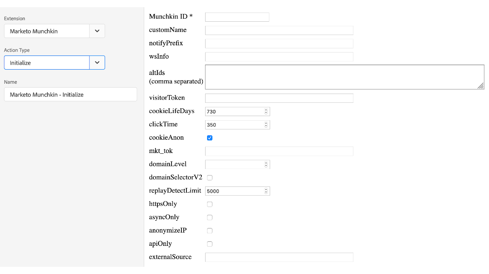
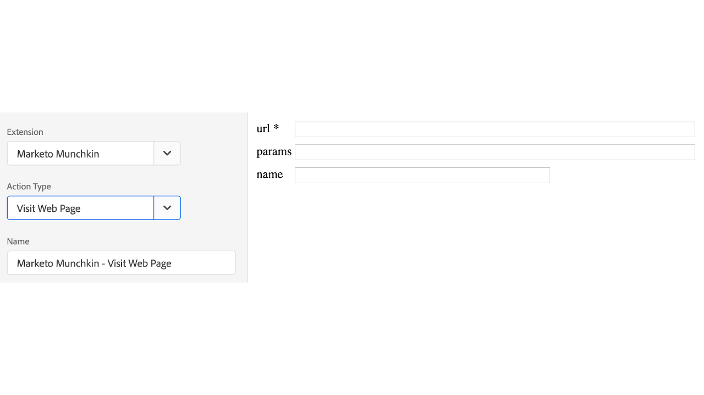
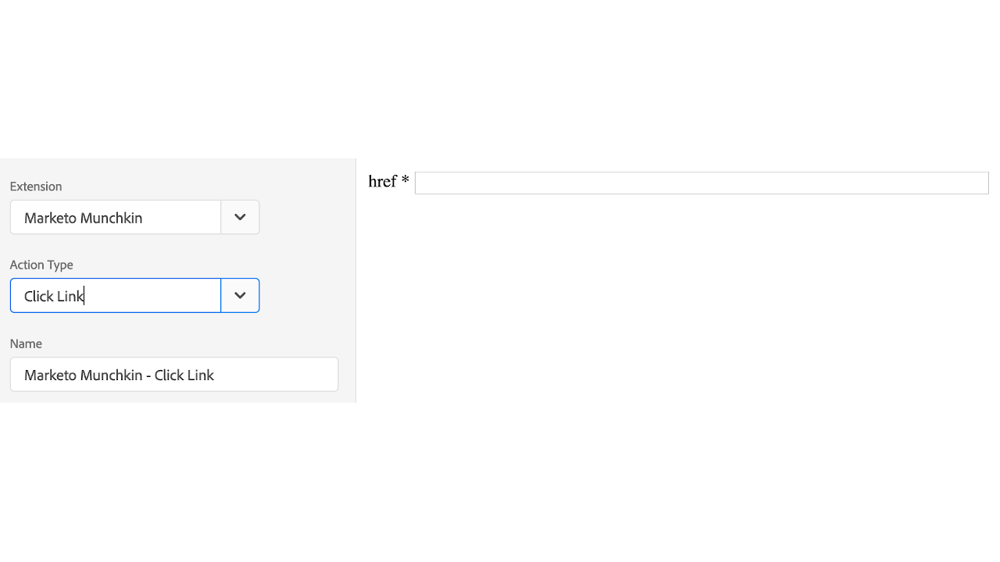

# Marketo Munchkin extension overview

Use this extension to integrate the [!DNL Marketo Munchkin] JavaScript tracking code with your property. [!DNL Marketo Munchkin] JavaScript allows for tracking of end-user page visits and navigates to your Marketo landing pages and external web pages.

## Install Marketo Munchkin extension

If [!DNL Marketo Munchkin] extension is not yet installed, open your property, then select **[!UICONTROL Extensions > Catalog]**, hover over the [!DNL Marketo Munchkin] extension, and select **[!UICONTROL Install]**.

This extension has no necessary configuration.

## Marketo Munchkin extension action types

This section describes the action types available int he [!DNL Marketo Munchkin] extension.

### Initialize

**Munchkin ID: (required)** Munchkin Account ID found under Admin > Integration > Munchkin menu.

**Configurations:** All configurable parameters are documented [here](https://developers.marketo.com/javascript-api/lead-tracking/configuration/)

### Visit web page

**url: (required)** The URL file path used to record a page visit.

**params:** A query string of the desired parameters to be recorded.

**name:** The custom name of the web page asset.

### Click link

**href: (required)** The URL file path used to record a link select.
