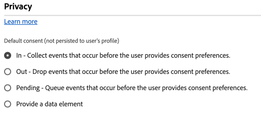

# Consent configuration settings {#consent}

>[!CONTEXTUALHELP]
>id="platform_tags_websdk_consent"
>title="Consent"
>abstract="Selects the default level of consent that is assumed if no other explicit consent preference is provided."

The **[!UICONTROL Consent]** section allows you to select the default level of consent that is assumed if no other explicit consent preference is provided. Default consent level is not saved to user profiles.

1. Log in to [CX Enterprise](https://experience.adobe.com) using your Adobe ID credentials.
1. Navigate to **[!UICONTROL Data Collection]** > **[!UICONTROL Tags]**.
1. Select the desired tag property.
1. Navigate to **[!UICONTROL Extensions]**, then select **[!UICONTROL Configure]** on the [!UICONTROL Adobe Experience Platform Web SDK] card.
1. Scroll down to the **[!UICONTROL Consent]** section.

This section contains a single set of radio buttons which determines the default consent level:

* **[!UICONTROL In]**: Collect events that occur before the user provides consent preferences.
* **[!UICONTROL Out]**: Drop events that occur before the user provides consent preferences.
* **[!UICONTROL Pending]**: Queue events that occur before the user provides consent preferences. When consent is granted, queued events are sent to Adobe. When consent is denied, queued events are discarded.
* **[!UICONTROL Provide a data element]**: Select a data element that determines one of the above configuration settings. Valid values include the strings `"in"`, `"out"`, or `"pending"`.

If your organization requires explicit user consent to collect data, Adobe recommends setting default consent to either **[!UICONTROL Out]** or **[!UICONTROL Pending]**.
