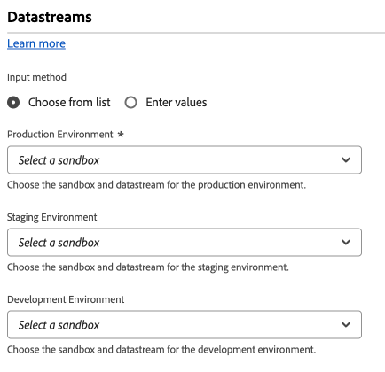

# Datastream configuration settings {#datastreams}

>[!CONTEXTUALHELP]
>id="platform_tags_websdk_datastreams"
>title="Datastreams"
>abstract="Required. Sets the datastream within the Edge Network that you want to send data to."

This configuration section allows you to determine which [datastream](/help/datastreams/overview.md) that you want to send data to. **A datastream ID is required for all data sent to the Edge Network.**

1. Log in to [CX Enterprise](https://experience.adobe.com) using your Adobe ID credentials.
1. Navigate to **[!UICONTROL Data Collection]** > **[!UICONTROL Tags]**.
1. Select the desired tag property.
1. Navigate to **[!UICONTROL Extensions]**, then select **[!UICONTROL Configure]** on the [!UICONTROL Adobe Experience Platform Web SDK] card.
1. Scroll down to the **[!UICONTROL Datastreams]** section.

When selecting datastreams, you can do so for each [environment](/help/tags/ui/publishing/environments.md) ([!UICONTROL Development], [!UICONTROL Staging], and [!UICONTROL Production]). These fields are valuable when you want to separate data sent between development, staging, and production environments. It enables a convenient workflow where you do not need to worry about sending data to the wrong datastream, as long as you install the correct tag loader in each respective environment.

Each environment has its own field: **[!UICONTROL Production datastream]**, **[!UICONTROL Staging datastream]**, and **[!UICONTROL Development datastream]**. The production datastream is required. If you leave the staging or development field empty, that environment uses the production datastream.

You can populate each field using any of the following methods:

* **Choose a datastream**: Select the field to view the [datastreams](/help/datastreams/overview.md) in every [sandbox](/help/sandboxes/ui/overview.md) that you have access to, grouped by sandbox. To filter the list, type part of a datastream name or ID.
* **Enter a datastream ID**: Type or paste a datastream ID directly into the field.
* **Use a data element**: Select the data element icon next to the field to choose a [data element](/help/tags/ui/managing-resources/data-elements.md) that returns a datastream ID.

When you choose a datastream from the list, the extension saves the datastream ID along with its sandbox. Datastream IDs and data elements that you enter are saved exactly as entered. Next to each field, select the refresh icon to reload the list of datastreams, or the copy icon to copy the datastream ID to your clipboard.

To choose datastreams from the list, your role must include the **[!UICONTROL View Datastreams]** permission, along with access to the relevant sandboxes. See the [resource permissions](/help/access-control/home.md#permissions) reference for more information. Datastream suggestions are also unavailable for additional Web SDK instances that use a different organization than the one that you are signed in to. In these cases, you can still enter a datastream ID or select a data element.
