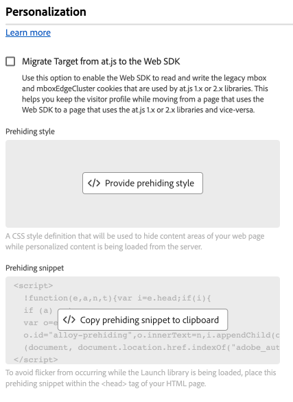

# Personalization configuration settings {#personalization}

>[!CONTEXTUALHELP]
>id="platform_tags_websdk_personalization"
>title="Personalization"
>abstract="Determines how the tag extension treats personalized content."

This configuration section allows you to determine how you want to hide certain parts of the page while personalized content is loaded. When configured correctly, these settings ensure that your visitors see the right personalized content.

1. Log in to [CX Enterprise](https://experience.adobe.com) using your Adobe ID credentials.
1. Navigate to **[!UICONTROL Data Collection]** > **[!UICONTROL Tags]**.
1. Select the desired tag property.
1. Navigate to **[!UICONTROL Extensions]**, then select **[!UICONTROL Configure]** on the [!UICONTROL Adobe Experience Platform Web SDK] card.
1. Scroll down to the **[!UICONTROL Personalization]** section.

The following options are available:

## [!UICONTROL Migrate Target from at.js to the Web SDK]**

Use this option to allow the Web SDK to read and write the legacy `mbox` and `mboxEdgeCluster` cookies that are used by the `at.js` 1.x or 2.x libraries. This setting helps keep visitor profiles intact while moving between pages using the Web SDK or `at.js` on the same website. If you do not have `at.js` implemented anywhere on your site, you do not need to enable this checkbox. The JavaScript library equivalent to this checkbox is [`targetMigrationEnabled`](/help/collection/js/commands/configure/targetmigrationenabled.md).

When enabling this option, make sure that you also enable [`overrideMboxEdgeServer`](https://experienceleague.adobe.com/en/docs/target-dev/developer/client-side/at-js-implementation/functions-overview/targetglobalsettings#overridemboxedgeserver) in `targetGlobalSettings()`.

## [!UICONTROL Prehiding style] {#prehiding-style}

The prehiding style editor allows you to define custom CSS rules to hide specific sections of a page. When the page is loaded, the Web SDK uses this style to hide the sections which need to be personalized, retrieves the personalization, then un-hides the personalized page sections. This workflow allows visitors see personalized content without seeing the personalization retrieval process load in or flicker. The JavaScript library equivalent to this code editor is [`prehidingStyle`](/help/collection/js/commands/configure/prehidingstyle.md).

## [!UICONTROL Prehiding snippet] {#prehiding-snippet}

This section is not a direct configuration setting, but rather a convenient location where you can obtain implementation code. Implement this prehiding snippet within the `<head>` tag on your site to hide the desired content while the Web SDK library loads.

>[!IMPORTANT]
>
>When using the prehiding snippet, Adobe recommends using the same CSS rule between the prehiding snippet and prehiding style.

## [!UICONTROL Enable personalization storage]

A checkbox that allows the Web SDK to store personalization events. in the browser's local storage. It is valuable when you want to keep track of which experiences that the visitor has seen across page loads.

## [!UICONTROL Auto click collection for Adobe Journey Optimizer]

A drop-down menu that determines when the Web SDK automatically collects clicks on content returned from Adobe Journey Optimizer.

* **[!UICONTROL Always]**: Collect all interactions with propositions.
* **[!UICONTROL Decorated elements only]**: Only collect interactions on elements with `data-aep-click-label` or `data-aep-click-token` HTML attributes.
* **[!UICONTROL Never]**: Do not collect interactions with propositions.

The JavaScript library equivalent to this drop-down menu is [`autoCollectPropositionInteractions.AJO`](/help/collection/js/commands/configure/autocollectpropositioninteractions.md). Its default value is [!UICONTROL Always].

## [!UICONTROL Auto click collection for Adobe Target]

A drop-down menu that determines when the Web SDK automatically collects clicks on content returned from Adobe Target.

* **[!UICONTROL Always]**: Collect all interactions with propositions.
* **[!UICONTROL Decorated elements only]**: Only collect interactions on elements with `data-aep-click-label` or `data-aep-click-token` HTML attributes.
* **[!UICONTROL Never]**: Do not collect interactions with propositions.

The JavaScript library equivalent to this drop-down menu is [`autoCollectPropositionInteractions.TGT`](/help/collection/js/commands/configure/autocollectpropositioninteractions.md). Its default value is [!UICONTROL Never].
