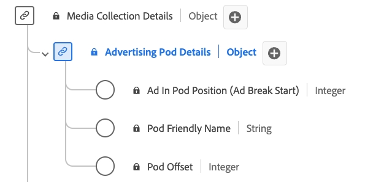

# [!UICONTROL Advertising Pod Details] Collection data type

[!UICONTROL Advertising Pod Details] Collection is a standard Experience Data Model (XDM) data type. It defines a sequence or group of ads typically played in succession during content breaks. Use the [!UICONTROL Advertising Pod Details] Collection data type to capture details such as the ad break ID, a friendly name for the ad break, the index of ads within the break, and the offset of the ad break within the content's timeline in seconds.

+++Select to display a diagram of the [!UICONTROL Advertising Pod Details] Collection data type.

+++

>[!NOTE]
>
>This data type belongs to the `mediaCollection` schema — fields that your implementation sends to the streaming media backend. Adobe processes this data and produces the corresponding `mediaReporting` fields, which are ingested into Platform datasets. See [Streaming media XDM reporting schema](https://experienceleague.adobe.com/en/docs/media-analytics/using/implementation/edge/reporting-schema) for details.

Each display name contains a link to further information on its implementation variable. The linked pages contain details on the data collected by Adobe, implementation values, network parameters, and important considerations.

| Display name | Property | Data type | Required | Description |
|---|---|---|---|---|
| [[!UICONTROL Ad In Pod Position]](https://experienceleague.adobe.com/en/docs/media-analytics/using/implementation/variables/ads/ad-in-pod-position) | `index` | integer | Yes | The index of the ad inside the parent ad break start. |
| [[!UICONTROL Pod Friendly Name]](https://experienceleague.adobe.com/en/docs/media-analytics/using/implementation/variables/ads/ad-break-name) | `friendlyName` | string | No | The easily understandable name of the ad break. |
| [[!UICONTROL Pod Offset]](https://experienceleague.adobe.com/en/docs/media-analytics/using/implementation/variables/ads/ad-break-start-time) | `offset` | integer | Yes | The offset of the ad break inside the content, in seconds. |
