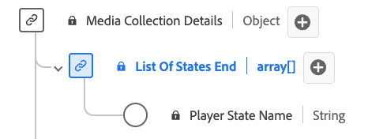

# [!UICONTROL List of States End] data type

The [!UICONTROL List of States End] data type is an Experience Data Model (XDM) data type designed for representing information related to the ending state of various player attributes. It includes the [!UICONTROL Player State Name] property that indicates the specific attribute state (for example, "fullscreen", "mute", "closedCaptioning"). This data type is used to capture and describe the ending conditions of different player states.

>[!NOTE]
>
>This data type belongs to the `mediaCollection` schema — fields that your implementation sends to the streaming media backend. Adobe processes this data and produces the corresponding `mediaReporting` fields, which are ingested into Platform datasets. See [Streaming media XDM reporting schema](https://experienceleague.adobe.com/en/docs/media-analytics/using/implementation/edge/reporting-schema) for details.

| Display name | Property | Data type | Required | Description |
|---|---|---|---|---|
| [!UICONTROL Player State Name] | `name` | string | No | The name of the player state. Enumerated: "fullscreen", "mute", "closedCaptioning", "pictureInPicture", "inFocus" with respective meanings. |
