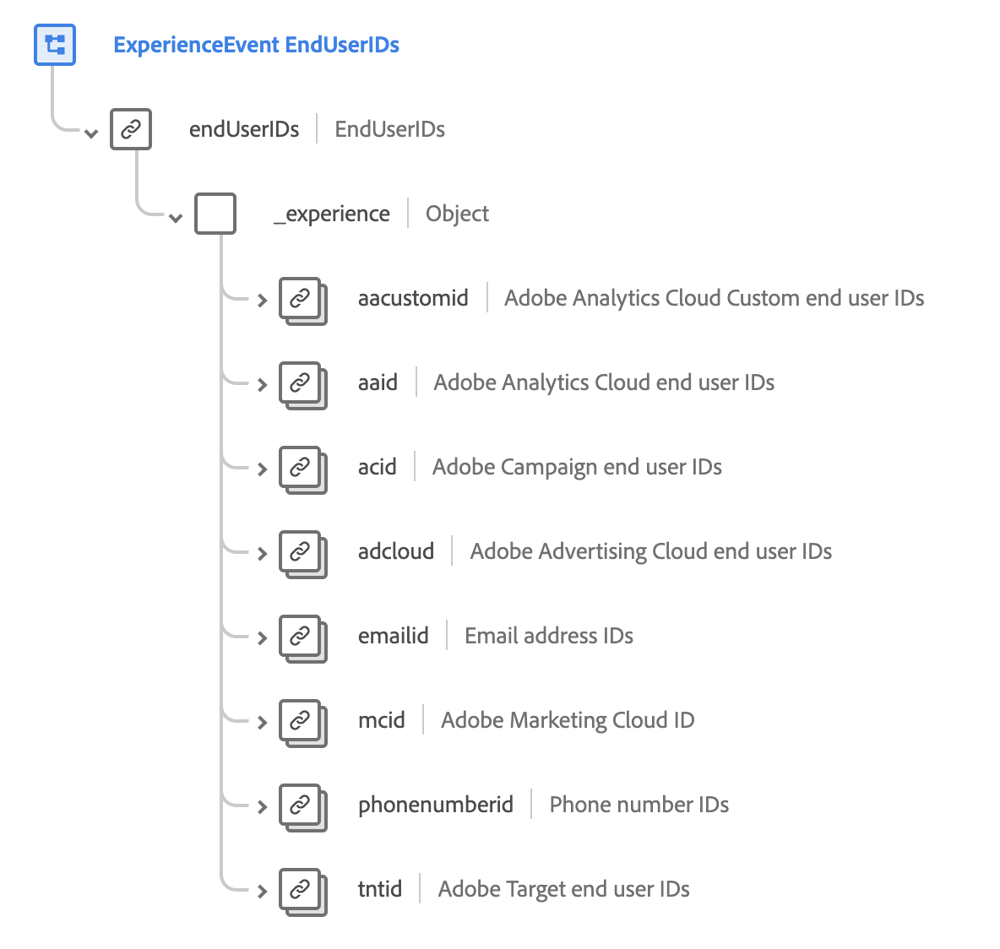

# [!UICONTROL End User ID Details] schema field group

>[!NOTE]
>
>The names of several schema field groups have changed. See the document on [field group name updates](../name-updates.md) for more information.

[!UICONTROL End User ID Details] is a standard schema field group for the [[!DNL XDM ExperienceEvent] class](../../classes/experienceevent.md), used to describe an individual's identity information across several Adobe applications. The field group provides a root-level `endUserIDs` object, which itself contains a read-only `_experience` field whose values are automatically updated as data is ingested.

{width=700}

| Property | Data type | Description |
| --- | --- | --- |
| `aacustomid` | [Identity](../../data-types/identity.md)  | Custom end user IDs for Adobe Analytics Cloud. |
| `aaid` | [Identity](../../data-types/identity.md) | End user IDs for Adobe Analytics Cloud. |
| `acid` | [Identity](../../data-types/identity.md) | End user IDs for Adobe Campaign. |
| `adcloud` | [Identity](../../data-types/identity.md) | End user IDs for Adobe Advertising. |
| `emailid` | [Identity](../../data-types/identity.md) | Email address IDs. |
| `mcid` | [Identity](../../data-types/identity.md) | Adobe Marketing Cloud ID (MCID). The MCID is now known as the Experience Cloud ID (ECID). |
| `phonenumberid` | [Identity](../../data-types/identity.md) | Phone number IDs. |
| `tntid` | [Identity](../../data-types/identity.md) | End user IDs for Adobe Target. |

{style="table-layout:auto"}

For more details on the field group, refer to the public XDM repository:

* [Populated example](https://github.com/adobe/xdm/blob/master/components/fieldgroups/experience-event/experienceevent-enduserids.example.1.json)
* [Full schema](https://github.com/adobe/xdm/blob/master/components/fieldgroups/experience-event/experienceevent-enduserids.schema.json)
